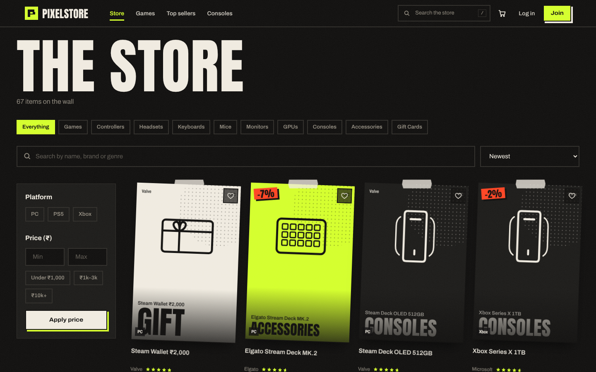
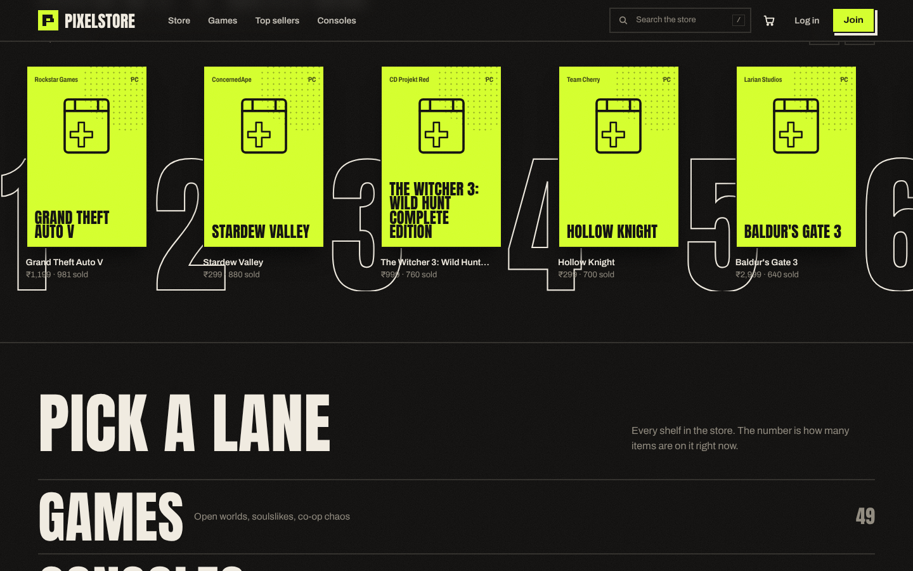
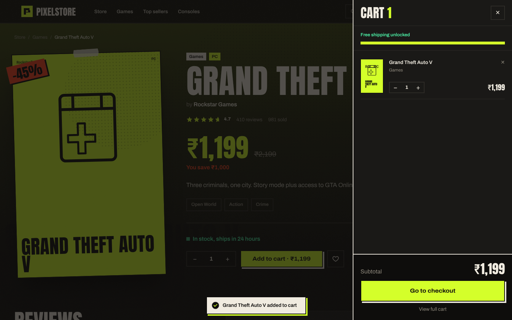
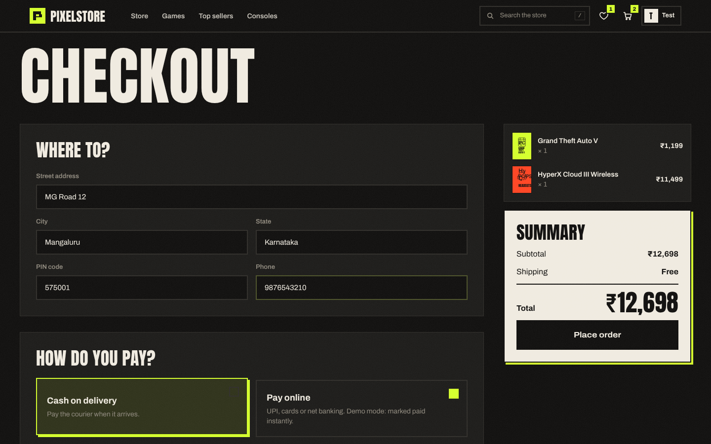
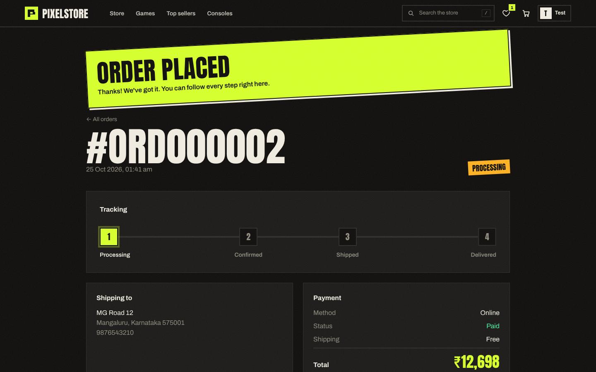
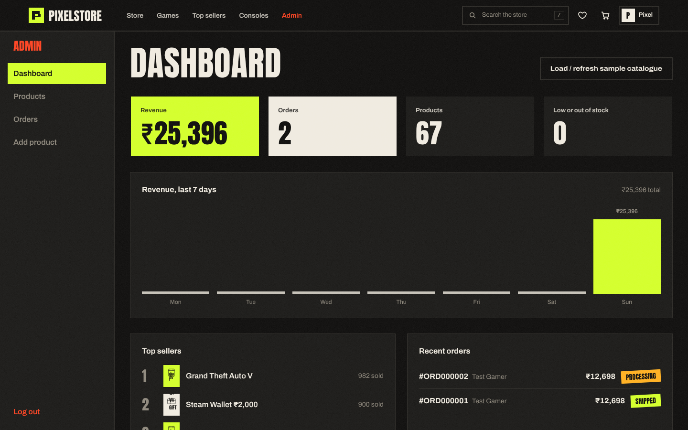

# 🎮 PixelStore

**PC games, consoles and gaming gear — a full-stack e-commerce store with a street-poster arcade look.**

Built with React, Node.js, Express, MongoDB and JWT. Product pages, cart, checkout, order tracking, a wishlist, reviews, and an admin dashboard. Every screen is animated with Framer Motion.

---

## 📸 Screenshots

| Home | Store |
|---|---|
|  |  |
| **Most played + categories** | **Product page** |
|  |  |
| **Cart drawer** | **Checkout** |
|  |  |
| **Order tracking** | **Admin dashboard** |
|  |  |

> Game posters are loaded from Steam's image CDN. If an image can't load, the card falls back to generated artwork (as in some screenshots).

---

## ✨ Features

### Store
- Hero "poster wall": columns of 49 real game posters drifting in a tilted, mouse-reactive wall
- Poster-style product cards with 3D tilt, glare, tape and sale stickers
- Instant search overlay (press `/` anywhere) with keyboard navigation
- Filter by category, platform, genre tag and price; sort by newest, best selling, top rated, price
- "Most played" top-10 row, category index, deal of the day with live countdown, genre stickers
- Product page with cinematic backdrop, reviews with star picker, and "More like this"
- Slide-out cart drawer, free-shipping progress meter, animated quantity changes
- Checkout with address validation, Cash on Delivery or Online (demo) payment
- Order history and animated order tracker (Processing → Confirmed → Shipped → Delivered)
- Wishlist (heart any product), profile with saved address
- Fully responsive, keyboard accessible, respects reduced-motion settings

### Admin
- Dashboard with animated stats, 7-day revenue chart, top sellers, recent orders
- Add / edit / delete products, image upload (Multer), optional Steam app ID for official posters
- Manage orders and update status (cancelling returns stock automatically)
- One-click sample catalogue: **49 PC games + 18 gaming gear products**

### Backend hardening
- Order prices are calculated on the server from the database, never trusted from the browser
- Stock is reserved atomically, so two buyers can't buy the last unit
- Search input is escaped (no regex crashes), invalid IDs return 404 instead of 500
- Seeding is non-destructive: re-running it refreshes posters but keeps stock, sales and reviews

---

## 🛠 Tech Stack

| Layer | Tech |
|---|---|
| Frontend | React 18 + Vite |
| Styling | Tailwind CSS (custom design tokens), Anton + Archivo fonts |
| Animation | Framer Motion |
| Routing | React Router v6 |
| State | Context API (auth, cart, wishlist) |
| HTTP | Axios |
| Backend | Node.js + Express |
| Database | MongoDB Atlas + Mongoose |
| Auth | JWT + bcryptjs |
| Uploads | Multer |

---

## 📁 Project Structure

```
PixelStore/
├── client/                      # React + Vite frontend
│   └── src/
│       ├── components/
│       │   ├── common/          # Poster, ArtPoster, ProductCard, Stars, Loader, Marquee, ProtectedRoute
│       │   ├── home/            # PosterWall, TopTen, CategoryIndex, DealOfDay
│       │   └── layout/          # Navbar, SearchOverlay, CartDrawer, Footer, Logo
│       ├── context/             # AuthContext, CartContext, WishlistContext
│       ├── pages/               # Home, Products, ProductDetails, Cart, Checkout, Orders, Profile, Auth, Admin, NotFound
│       ├── utils/               # api, format, posters
│       ├── App.jsx
│       └── index.css
├── server/                      # Node + Express API
│   ├── config/db.js
│   ├── controllers/             # auth, product, order, wishlist
│   ├── data/seedProducts.js     # sample catalogue (67 products)
│   ├── middleware/              # auth, upload
│   ├── models/                  # User, Product, Order
│   ├── routes/
│   ├── uploads/
│   ├── index.js
│   └── .env.example
├── screenshots/
└── package.json
```

---

## 🚀 Run it locally

**Needs:** Node.js 18+ and a MongoDB Atlas database (free tier works).

```bash
# 1. Install everything
npm run install-all

# 2. Configure the server
cp server/.env.example server/.env      # then put your MongoDB URI and a JWT secret in it

# 3. Start API + frontend together
npm run dev
```

Open **http://localhost:5173**

### First-time setup
1. Go to **Log in → Use demo admin**, then log in (`admin@pixelstore.com` / `admin123`)
2. On the home page or **Admin → Dashboard**, click **Load sample catalogue**

---

## 🌐 API

| Method | Route | Access | Description |
|---|---|---|---|
| POST | /api/auth/register | Public | Register |
| POST | /api/auth/login | Public | Log in |
| POST | /api/auth/seed-admin | Public | Create demo admin |
| GET / PUT | /api/auth/profile | User | Get / update profile |
| GET | /api/products | Public | List (search, category, platform, tag, price, sort, page) |
| GET | /api/products/categories | Public | Product count per category |
| GET | /api/products/:id | Public | Single product |
| POST / PUT / DELETE | /api/products/:id | Admin | Create / update / delete |
| POST | /api/products/:id/review | User | Add review |
| GET | /api/products/stats | Admin | Product stats |
| POST | /api/products/seed | Admin | Load sample catalogue |
| POST | /api/orders | User | Place order |
| GET | /api/orders/my | User | My orders |
| GET | /api/orders/:id | User | Order details |
| GET | /api/orders/admin/all | Admin | All orders |
| GET | /api/orders/admin/stats | Admin | Revenue + 7-day chart |
| PUT | /api/orders/:id/status | Admin | Update status |
| GET | /api/wishlist | User | Wishlist |
| POST | /api/wishlist/toggle/:id | User | Add / remove |

---

## ☁️ Deploy

**Backend → Render:** root `server`, build `npm install`, start `node index.js`, add the `.env` variables (set `CLIENT_URL` to your frontend URL).

**Frontend → Vercel:** root `client`, build `npm run build`, output `dist`, add env `VITE_API_URL=https://your-api.onrender.com/api`.

---

## 👤 Author

**Siddharth Bhat** — [GitHub @SiddharthBhat120](https://github.com/SiddharthBhat120)

## 📄 License

MIT
